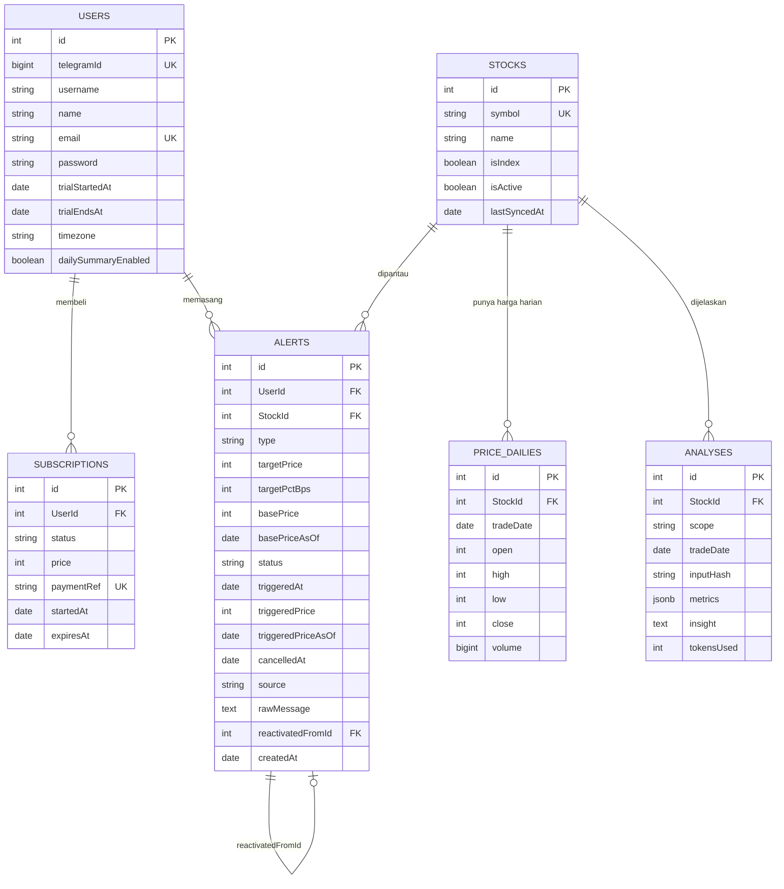

# ERD.md — Relasi Antar Tabel

> Kolom lengkap ada di `ARCHITECTURE.md §2`. File ini menjelaskan **relasi,
> constraint, dan aturan integritas** — hal-hal yang kalau salah, datanya rusak
> pelan-pelan tanpa ketahuan.

---

## 1. Diagram



Yang **bukan tabel** (in-memory, `ARCHITECTURE.md §2`): cache harga intraday,
state input menggantung, `update_id` yang sudah diproses.

## 2. Kardinalitas

| Relasi | Kardinalitas | Catatan |
|---|---|---|
| Users → Subscriptions | 1 : N | Riwayat pembelian. Hanya satu boleh `active` |
| Users → Alerts | 1 : N | Termasuk yang `triggered` / `cancelled` (riwayat) |
| Stocks → Alerts | 1 : N | Alert hanya untuk saham `isIndex = false` |
| Stocks → PriceDailies | 1 : N | Unik per saham per tanggal bursa |
| Stocks → Analyses | 1 : N | Unik per saham per scope per tanggal bursa |
| Alerts → Alerts | 1 : 0..N | `reactivatedFromId` — satu alert lama bisa diaktifkan lagi berkali-kali |

## 3. Constraint yang Wajib Ada di Migration

### Unique
```sql
UNIQUE (Users.telegramId)
UNIQUE (Users.email) WHERE email IS NOT NULL
UNIQUE (Subscriptions.paymentRef) WHERE paymentRef IS NOT NULL
UNIQUE (Stocks.symbol)
UNIQUE (PriceDailies.StockId, PriceDailies.tradeDate)
UNIQUE (Analyses.StockId, Analyses.scope, Analyses.tradeDate)

-- Hanya satu subscription aktif per user:
CREATE UNIQUE INDEX one_active_sub
  ON "Subscriptions"("UserId") WHERE status = 'active';
```

### Check
```sql
CHECK (Stocks.symbol ~ '^[A-Z]{4}$' OR Stocks."isIndex" = true)

CHECK (Alerts.type IN ('price_below','price_above','pct_drop','pct_rise','below_avg_30d'))
CHECK (Alerts.status IN ('active','triggered','cancelled'))
CHECK (Alerts.source IN ('text','command','callback','dashboard'))
CHECK (Alerts."basePrice" > 0)
CHECK (Alerts."targetPrice" IS NULL OR Alerts."targetPrice" > 0)
-- targetPrice wajib kecuali below_avg_30d:
CHECK (Alerts.type = 'below_avg_30d' OR Alerts."targetPrice" IS NOT NULL)
-- targetPctBps hanya untuk pct_*, dan wajib di sana:
CHECK ((Alerts.type IN ('pct_drop','pct_rise')) = (Alerts."targetPctBps" IS NOT NULL))
CHECK (Alerts."targetPctBps" IS NULL OR Alerts."targetPctBps" BETWEEN 1 AND 9000)
-- kolom trigger terisi hanya kalau status triggered:
CHECK ((Alerts.status = 'triggered') = (Alerts."triggeredAt" IS NOT NULL))
CHECK (Alerts.status <> 'triggered' OR Alerts."triggeredPrice" IS NOT NULL)
CHECK ((Alerts.status = 'cancelled') = (Alerts."cancelledAt" IS NOT NULL))

CHECK (PriceDailies.close > 0 AND PriceDailies.low <= PriceDailies.high)
CHECK (Analyses.scope IN ('alert_context'))
```

### Index (query yang paling sering dipakai)
```sql
-- alertCheckJob tiap 5 menit:
CREATE INDEX ON "Alerts" ("status", "StockId") WHERE status = 'active';
-- batas free (alert paling lama dibuat) & /daftar:
CREATE INDEX ON "Alerts" ("UserId", "status", "createdAt");
CREATE INDEX ON "PriceDailies" ("StockId", "tradeDate" DESC);
CREATE INDEX ON "Subscriptions" ("UserId", "status", "expiresAt");
```

### Perilaku ON DELETE
| Foreign key | Perilaku | Kenapa |
|---|---|---|
| `Alerts.UserId` | `RESTRICT` | Riwayat alert adalah bukti apa yang user minta |
| `Alerts.StockId` | `RESTRICT` | Saham tidak pernah dihapus, hanya `isActive = false` |
| `Alerts.reactivatedFromId` | `SET NULL` | Jejak saja, bukan ketergantungan |
| `PriceDailies.StockId` | `CASCADE` | Data turunan |
| `Analyses.StockId` | `CASCADE` | Cache, aman dibuang |
| `Subscriptions.UserId` | `RESTRICT` | Jejak pembayaran harus utuh |

## 4. Aturan yang TIDAK Bisa Dijaga Database (jadi wajib ada test-nya)

Ini yang paling sering bocor. Database tidak bisa menahannya, jadi kode dan test
yang harus.

1. **Kolom target alert tidak pernah di-UPDATE.** `type`, `targetPrice`,
   `targetPctBps`, `basePrice`, `basePriceAsOf`, `StockId`, `UserId` tetap
   seumur hidup. Yang boleh berubah hanya kolom status (`status`,
   `triggeredAt`, `triggeredPrice`, `triggeredPriceAsOf`, `cancelledAt`).
2. **Status hanya bergerak dari `active`.** `active → triggered` atau
   `active → cancelled`. Tidak ada jalan kembali ke `active`; [Aktifkan lagi]
   membuat baris baru.
3. **`active → triggered` wajib UPDATE bersyarat** `WHERE id = ? AND status = 'active'`
   dan notifikasi hanya dikirim kalau jumlah baris yang berubah = 1.
4. **`targetPrice` wajib kelipatan fraksi harga** untuk rentang harganya.
   DB tidak tahu tabel fraksi IDX.
5. **Batas alert aktif per tier.** DB tidak tahu tier. Dicek `alertService`
   lewat `entitlementService.maxActiveAlerts(tier)` sebelum insert.
6. **Tier tidak pernah disimpan.** Selalu `entitlementService.resolve()`.
7. **Trial sekali seumur hidup.** `trialStartedAt` hanya boleh ditulis kalau masih null.
8. **`update_id` Telegram tidak boleh diproses dua kali.**
9. **Alert hanya milik pemiliknya.** Callback `alert:*:<id>` dan
   `DELETE /api/alerts/:id` wajib cek `alert.UserId === user.id` → selain itu 404
   (bukan 403, supaya tidak membocorkan keberadaan alert orang lain).
10. **Stocks tidak pernah dihapus.** Delisting → `isActive = false`.
11. **Analyses maksimal satu per saham per hari** — dijaga unique constraint, tapi
    `contextService` wajib cek cache **sebelum** memanggil AI, bukan menangkap
    error unique setelahnya.

## 5. Seed Awal

- `Stocks`: diisi `stockSyncJob` saat pertama kali cron jalan, bukan seeder
  statis (daftar emiten berubah). Seeder hanya membuat baris `IHSG`
  (`isIndex: true`) dan 5 saham contoh untuk test: `BBCA`, `BBRI`, `TLKM`,
  `ANTM`, `GOTO`.
- Tidak ada seed alert. Tidak ada kategori (beda dengan Mon Mon).

## 6. Contoh Data Setelah Satu Alert Dibuat dan Kena

User trial kirim `kabarin bbca kalau 3000`, harga saat itu 3.120:

```
Users:        { id: 1, telegramId: 123456789, trialEndsAt: '2026-09-30',
                dailySummaryEnabled: true }
Stocks:       { id: 7, symbol: 'BBCA', isIndex: false, isActive: true }
Alerts:       { id: 12, UserId: 1, StockId: 7, type: 'price_below',
                targetPrice: 3000, targetPctBps: null, basePrice: 3120,
                basePriceAsOf: '2026-09-23T02:45:00Z', status: 'active',
                source: 'text', rawMessage: 'kabarin bbca kalau 3000',
                reactivatedFromId: null }
```

Jam 10:15 WIB harga 2.990 → `alertCheckJob`:
```
Alerts:       { id: 12, ..., status: 'triggered',
                triggeredAt: '2026-09-23T03:20:04Z', triggeredPrice: 2990,
                triggeredPriceAsOf: '2026-09-23T03:15:00Z' }
Analyses:     { id: 3, StockId: 7, scope: 'alert_context', tradeDate: '2026-09-23',
                inputHash: 'b71c...', metrics: {...}, insight: 'BBCA ditutup...',
                tokensUsed: 212 }
```

User **free** yang sama → baris `Alerts` identik (kalau `price_below`/`price_above`
dan masih dalam batas 2 alert), tapi **tidak ada baris `Analyses` yang dibuat
atau dibaca** untuk notifikasinya.

User menekan [Aktifkan lagi] saat harga 2.990:
```
Alerts:       { id: 13, UserId: 1, StockId: 7, type: 'price_below',
                targetPrice: 3000, ... }   ← DITOLAK: 3.000 ≥ harga sekarang 2.990
```
Bot membalas "Harga sekarang Rp 2.990 sudah di bawah Rp 3.000. [Geser target]".
Tidak ada baris baru.
